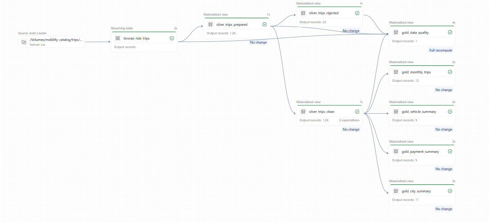
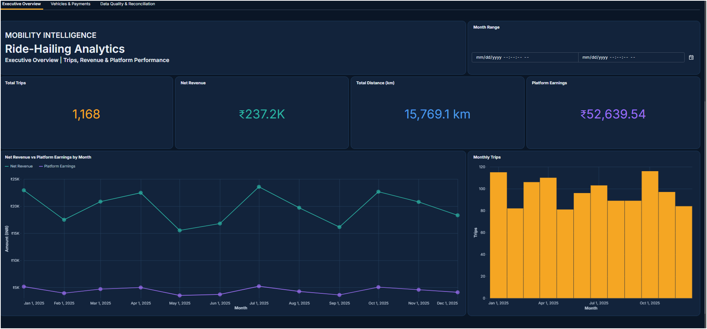
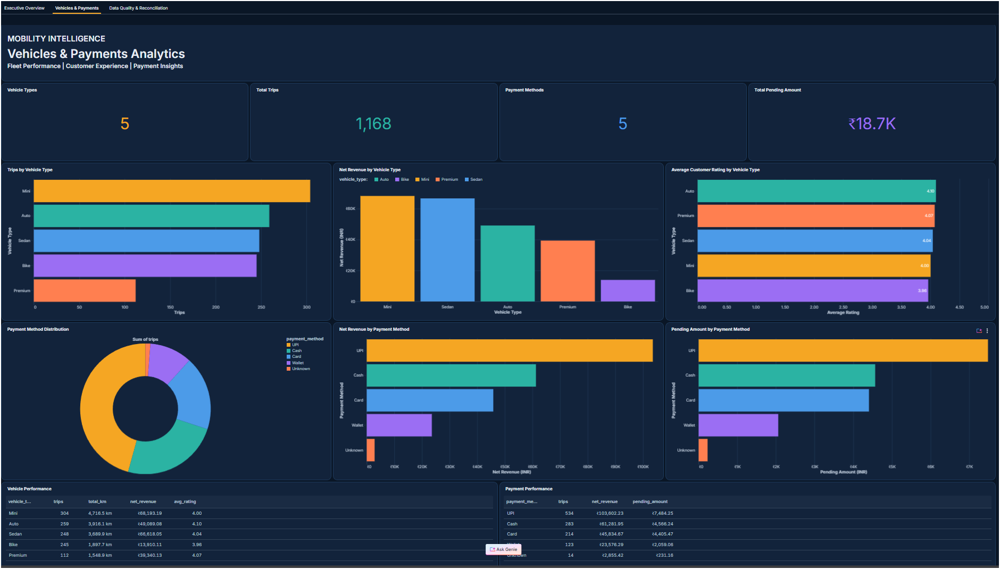
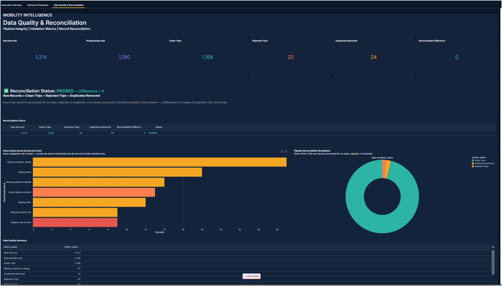

# Ride-Hailing Analytics | Databricks Medallion Architecture

### End-to-End Data Engineering & Business Intelligence Project

An end-to-end **Ride-Hailing Analytics solution** built using **Databricks, SQL, Delta Lake, Unity Catalog, Lakeflow Spark Declarative Pipelines and Databricks AI/BI Dashboards**.

This project demonstrates how raw ride-hailing trip data can be ingested, cleaned, validated and transformed into business-ready datasets using the **Bronze, Silver and Gold Medallion Architecture**.

The solution includes automated file ingestion using Auto Loader, SQL-based transformations, duplicate handling, data-quality validation, record reconciliation and an interactive three-page business intelligence dashboard.

## Project Highlights

| Metric | Result |
|---|---:|
| Raw Trip Records | 1,214 |
| Unique Trips | 1,190 |
| Clean Trips | 1,168 |
| Duplicate Records | 24 |
| Rejected Records | 22 |
| Net Revenue | ₹237,150.56 |
| Platform Earnings | ₹52,639.54 |
| Total Distance | 15,769.1 km |
| Gold Materialized Views | 5 |
| Dashboard Pages | 3 |
| Reconciliation Status | PASSED |

## Technologies Used

| Technology | Implementation |
|---|---|
| Databricks | Data engineering and analytics platform |
| Databricks SQL | Data transformations, validation and aggregations |
| Unity Catalog | Data organization and governance |
| Delta Lake | Storage foundation for managed analytical tables |
| Auto Loader | Incremental CSV file ingestion |
| Streaming Tables | Bronze-layer ingestion |
| Lakeflow Spark Declarative Pipelines | Medallion pipeline orchestration |
| Materialized Views | Silver and Gold transformations |
| Databricks AI/BI Dashboards | Interactive business intelligence reporting |

## Business Objective

The objective of this project is to convert raw ride-hailing transaction data into reliable, actionable business insights.

The solution focuses on improving data quality, monitoring trip volumes and revenue, comparing vehicle performance, understanding customer payment preferences and maintaining transparent record reconciliation.

By separating ingestion, cleaning and business aggregations into dedicated layers, the project demonstrates a structured approach to building analytical data pipelines.

## Data Architecture & Pipeline

This project follows the **Medallion Architecture**, using Bronze, Silver and Gold layers to organize ingestion, data cleaning, validation and business aggregations.

### End-to-End Data Flow

```text
             Raw Ride-Hailing CSV Dataset
                          |
                          v
               Unity Catalog Volume
                          |
                          v
                BRONZE LAYER
                 bronze_ride_trips
             Auto Loader + Streaming Table
                   1,214 Records
                          |
                          v
                 SILVER LAYER
               silver_trips_prepared
                 1,190 Unique Trips
                          |
                 +--------+--------+
                 |                 |
                 v                 v
         silver_trips_clean  silver_trips_rejected
             1,168 Trips          22 Trips
                 |
                 v
                  GOLD LAYER
          Business Materialized Views
                 |
       +---------+---------+
       |         |         |
       v         v         v
     Monthly   Vehicle   Payment
     Summary   Summary   Summary
       |
       +------ City Summary

     Data Quality & Reconciliation
       (Uses Multiple Pipeline Layers)
                 |
                 v
          Databricks AI/BI
          3-Page Dashboard
```

### Pipeline Layers

| Layer | Dataset | Purpose |
|---|---|---|
| Bronze | `bronze_ride_trips` | Raw CSV ingestion using Auto Loader |
| Silver | `silver_trips_prepared` | Deduplication and data preparation |
| Silver | `silver_trips_clean` | Validated trip records |
| Silver | `silver_trips_rejected` | Records failing validation |
| Gold | `gold_monthly_trips` | Monthly trips and financial performance |
| Gold | `gold_vehicle_summary` | Vehicle-category analytics |
| Gold | `gold_payment_summary` | Payment-method analytics |
| Gold | `gold_city_summary` | City-level analytics |
| Gold | `gold_data_quality` | Data-quality monitoring and reconciliation |

### Pipeline Execution

The data transformations are implemented using **Databricks SQL and Lakeflow Spark Declarative Pipelines**.

The pipeline reads raw CSV data from a Unity Catalog Volume, removes duplicate trips, separates clean and rejected records, and produces five Gold materialized views.

The Gold datasets are then used in the Databricks AI/BI dashboard for business reporting and data-quality monitoring.

### SQL Implementation

The SQL scripts are organized by Medallion layer:

- [Bronze SQL Scripts](sql/bronze/)
- [Silver SQL Scripts](sql/silver/)
- [Gold SQL Scripts](sql/gold/)

### Pipeline Execution Screenshot



The pipeline graph shows the dependencies between Bronze, Silver and Gold datasets and the successful execution of the transformations.

For detailed implementation information, see the [Architecture & Workflow Documentation](docs/architecture_and_workflow.md).

## Interactive Databricks AI/BI Dashboard

Developed and published a three-page interactive dashboard using Databricks AI/BI Dashboards to monitor ride-hailing performance, payment behavior and pipeline data quality.

### 1. Executive Overview



The Executive Overview provides a consolidated view of the ride-hailing business using four primary KPIs.

| KPI | Value |
|---|---:|
| Total Trips | 1,168 |
| Net Revenue | ₹237,150.56 |
| Total Distance | 15,769.1 km |
| Platform Earnings | ₹52,639.54 |

**Key Features:**

- Monthly trip volume analysis
- Monthly net revenue and platform earnings trends
- Interactive month range filtering
- High-level business performance monitoring

The month range filter was tested successfully. Selecting April 2025 displayed 110 trips, with the corresponding financial metrics and charts updating for the selected period.

### 2. Vehicles & Payments Analytics



This page analyzes vehicle-category performance and customer payment preferences.

**Vehicle Performance:**

| Vehicle Type | Total Trips |
|---|---:|
| Mini | 304 |
| Auto | 259 |
| Sedan | 248 |
| Bike | 245 |
| Premium | 112 |

**Key Insight:** Mini recorded the highest number of trips, contributing approximately 26% of all validated trips.

**Payment Method Analysis:**

| Payment Method | Total Trips |
|---|---:|
| UPI | 534 |
| Cash | 283 |
| Card | 214 |
| Wallet | 123 |
| Unknown | 14 |

**Key Insight:** UPI was the most frequently used payment method, accounting for approximately 46% of validated trips.

The dashboard also monitors payment-method revenue and approximately ₹18.7K in pending payments.

### 3. Data Quality & Reconciliation



This page monitors the quality and completeness of records processed through the Medallion Architecture.

**Pipeline Record Summary:**

| Metric | Count |
|---|---:|
| Raw Records | 1,214 |
| Prepared Records | 1,190 |
| Clean Records | 1,168 |
| Rejected Records | 22 |
| Duplicate Records | 24 |
| Reconciliation Difference | 0 |

**Reconciliation Status: PASSED**

The reconciliation check verifies:

```text id="h8x2qr"
Raw Records = Clean Records + Rejected Records + Duplicates

1,214 = 1,168 + 22 + 24
```

The dashboard also visualizes missing values, invalid distances, negative rates and other data-quality issues.

Individual issue counts may overlap and do not necessarily represent rejected records.

## Key Business Insights

Based on the validated trip records, the project identified the following findings:

1. **Vehicle Demand:** Mini was the most popular vehicle category, recording 304 trips, followed by Auto with 259 trips.
2. **Payment Preferences:** UPI dominated payment usage with 534 trips, followed by Cash with 283 trips.
3. **Financial Performance:** The validated trips generated ₹237,150.56 in net revenue and ₹52,639.54 in platform earnings.
4. **Pending Payments:** Approximately ₹18.7K in pending payments was identified for monitoring.
5. **Data Quality:** The pipeline identified 24 duplicate records and 22 rejected records before producing 1,168 clean trips.
6. **Reconciliation:** The final record-count reconciliation returned a difference of zero, confirming that all ingested records were accounted for.

These insights demonstrate how the Gold layer supports business reporting while the data-quality layer provides transparency into pipeline reliability.

## Data Quality & Reconciliation

Data quality is an important component of this project. The pipeline implements deduplication, record validation and reconciliation to ensure reliable business reporting.

**Data Processing Summary:**

| Processing Stage | Records |
|---|---:|
| Bronze — Raw Records | 1,214 |
| Silver — Unique Records | 1,190 |
| Silver — Clean Records | 1,168 |
| Silver — Rejected Records | 22 |
| Duplicate Records | 24 |

**Reconciliation Formula:**

```text
Raw Records = Clean Records + Rejected Records + Duplicate Records

1,214 = 1,168 + 22 + 24

Reconciliation Difference = 0
Status = PASSED
```

The pipeline also monitors missing values, invalid distances and negative rates.

Rejected records are preserved separately for investigation instead of being permanently discarded.

## Project Folder Structure

```text
Ride_Hailing_Analytics_Databricks_Project/
│
├── README.md
│
├── sql/
│   ├── bronze/
│   ├── silver/
│   └── gold/
│
├── screenshots/
│   ├── pipeline_graph.png
│   ├── dashboard_overview.png
│   ├── dashboard_vehicles_payments.png
│   └── dashboard_data_quality.png
│
└── docs/
    └── architecture_and_workflow.md
```

### Repository Contents

| Folder / File | Description |
|---|---|
| `sql/bronze/` | Raw data ingestion SQL |
| `sql/silver/` | Data preparation, deduplication and validation SQL |
| `sql/gold/` | Business aggregations and data-quality SQL |
| `screenshots/` | Pipeline execution and dashboard screenshots |
| `docs/architecture_and_workflow.md` | Detailed architecture, implementation, validation and project documentation |
| `README.md` | Project overview, architecture, results and insights |

## Key Technical Learnings

Through this project, I gained hands-on experience in:

- Implementing the Medallion Architecture using Databricks.
- Managing datasets using Unity Catalog and Volumes.
- Ingesting CSV files using Auto Loader and streaming tables.
- Building transformations using Databricks SQL and Lakeflow Spark Declarative Pipelines.
- Applying SQL window functions for deduplication.
- Separating validated and rejected records.
- Creating Gold materialized views for business reporting.
- Understanding data grain and preventing double counting.
- Implementing record reconciliation and data-quality monitoring.
- Developing interactive dashboards using Databricks AI/BI.

## Future Enhancements

Potential improvements include:

- Scheduling pipeline execution and monitoring failures.
- Processing newly arriving trip files incrementally.
- Introducing automated data-quality alerts.
- Expanding the dataset for year-over-year analysis.
- Adding advanced revenue and operational KPIs.
- Testing pipeline performance with larger datasets.

## Project Documentation

For a detailed explanation of the architecture, transformations, data validation and implementation workflow, refer to:

**[Architecture & Workflow Documentation](docs/architecture_and_workflow.md)**

## Conclusion

This project demonstrates an end-to-end data engineering and analytics solution using Databricks.

The pipeline processes raw ride-hailing trip data through Bronze, Silver and Gold layers, producing validated analytical datasets and business-ready materialized views.

With **1,168 clean trips, five Gold materialized views, three interactive dashboard pages and successful record reconciliation**, the project demonstrates practical skills in SQL, data engineering, data quality and business intelligence.

